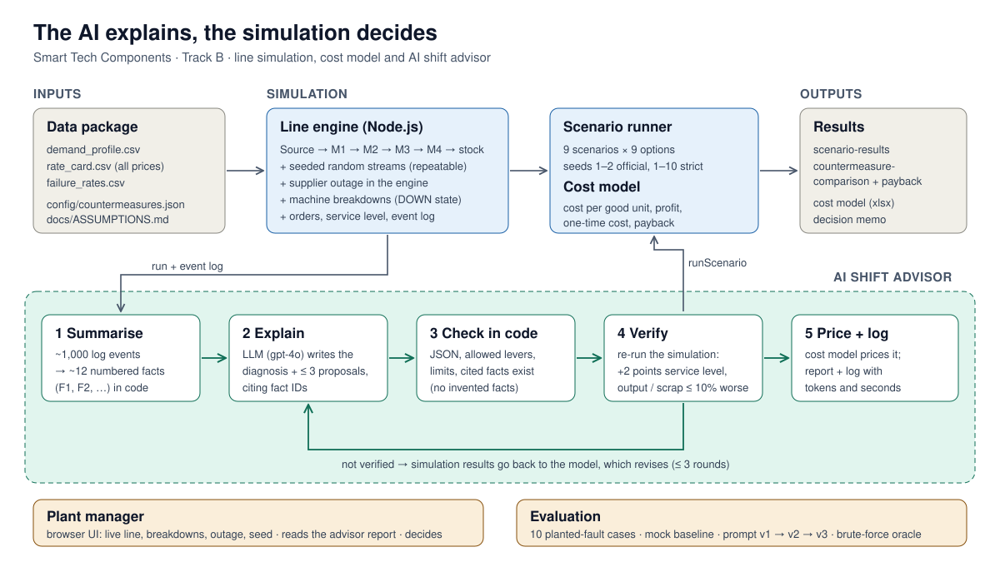

# Machine simulation: production line case (Track B)

Extended from the organisers' `machine_sim` starter. What we changed is listed under **Changes by our team** below; the original starter documentation follows after it. All assumptions are in [`docs/ASSUMPTIONS.md`](docs/ASSUMPTIONS.md) and are referred to by their IDs (for example `SIM-02`).



## Deliverables at a glance

| Deliverable (Track B brief) | Where |
|---|---|
| Extended simulation, what was added and why, how validated, how to run | this README, sections 1–9 |
| Architecture figure (also a pitch slide) | `docs/architecture.svg` / `docs/architecture.png` |
| AI shift advisor | `src/advisor/`, `npm run advise` (section 10) |
| Advisor dashboard and chat in the browser | `http://localhost:3000/advisor.html` (section 14) |
| Log of how its proposals were verified | `results/advisor/advisor-log.jsonl`, reports in `results/advisor/` |
| How the advisor was evaluated and improved | section 11, `results/advisor-eval/summary.md` |
| Scenario results table with seeds, without and with the recommended countermeasure | `results/scenario-results.md` / `.csv` |
| Chosen countermeasure per scenario (re-run without the LLM) | `config/countermeasures.json`, `npm run scenarios` |
| Cost model and KPIs (spreadsheet) | `docs/business/cost-model.xlsx` |
| Countermeasure comparison with one-time cost and payback | `results/countermeasure-comparison.md`, sheet *Comparison* |
| Decision memo for the plant manager | `docs/DECISION_MEMO.md` |
| Assumptions table | `docs/ASSUMPTIONS.md` |

## Changes by our team

### 1. Seeded randomness (`SIM-01`, `SIM-02`)

**What:** the reject gate of M2 no longer uses `Math.random()`. All randomness comes from `src/simulation/random.js`: a seeded generator (mulberry32) with one named stream per random process (for example `reject:M2`). The seed is `config.seed` (default `1`; seed `0` is valid and not treated as "no seed"). `reset()` replays a run exactly. `runHeadless({ seed })` now has an effect.

**Why:** without a seed every run differs, so comparing a countermeasure with the baseline mixes the effect of the change with random noise. The brief's own example: unseeded, comparing the line with itself passes the 2-point rule in about 1 of 6 tries. Separate streams mean that adding a new random process later (machine breakdowns) does not change the reject sequence, so two configurations run with the same seed are compared fairly.

**How validated:** `test/seeding.test.js` (same seed → identical run; seeds 0, 1, 2 differ; reset replays; streams are independent; `Math.random` is never called). The spread over seeds 1–30 matches the spread the data README reports for the unseeded starter (see `results/reference-check.md`).

### 2. Supplier outage in the engine (`SUP-01`)

**What:** `config.source.outage = { startTick, endTick }` (or `null`). On the engine ticks `startTick < n <= endTick` the source is skipped: its counter does not advance, no part is released and no material is booked. The state reports `source.outage` and `source.inOutage`. The outage can be set at run time through `POST /api/control` with `params: { outage: { startTick, endTick } }` or cleared with `outage: null`; invalid values answer `400`.

**Why:** in the starter the outage existed only inside the headless helper, so neither the engine nor the UI could show the plant's main disruption.

**How validated:** `test/outage.test.js` runs the reference outage through the engine and through the helper's own `outage` option, for flat demand and the demand profile, seeds 1 and 2: per-shift rows, KPIs and the event log are **identical**. Further tests check the exact tick window, the frozen counter, set and clear at run time, and input validation.

### 3. Reference check (`SIM-05`)

**What:** `npm run reference` runs the four reference scenarios (`src/scenarios/reference.js`) with seeds 1 and 2, compares the average service level with the reference values (±2 points, ±5 with the outage), adds the mean and spread over seeds 1–30, and writes `results/reference-check.md`.

**Result:** all four scenarios pass (baseline 99.8%, supplier outage 75.0%, demand swing 56.3%, both 47.2% against 100 / 76 / 57 / 48).

**Also changed:** `src/headless/run.check.mjs` now gives each of its 20 runs its own seed (1–20). Otherwise all runs would use the same default seed and be identical.

### 4. Cost model inside the tool (`COST-*`)

**What:** `src/economics/rateCard.js` reads `data/rate_card.csv`; `src/economics/cost.js` turns any `runHeadless` result into revenue, machine, material, WIP and finished-goods holding, amortised one-time costs, lost sales, stock values, **cost per good unit** and **total profit**, following the cost rules of the data README. Cost per good unit is reported twice: without finished-goods holding (the organiser's baseline check) and with it (to compare stock options like with like, `COST-10`).

**Why:** the brief asks for cost and service level next to parts; nothing in the starter computed costs.

**How validated:** `test/cost.test.js`. The default line costs **EUR 102.9 per good unit** (seeds 1 and 2: 102.6 and 103.2) against the organiser's EUR 102.8. Each formula is checked on a hand-made example, and total profit equals the sum of its parts.

### 5. Countermeasures, pricing and verification

**What:**
- `src/scenarios/levers.js`: one format for countermeasures (starting stock, cycle time, reject rate, buffer capacity, source interval, extra machines), with the limits `LEV-01` to `LEV-08`. The advisor will use the same format.
- `src/economics/pricing.js`: the one-time cost of a countermeasure is derived from its lever changes and the rate card (for example M3 13 → 12 min = EUR 30,000). The advisor never prices; this code does.
- `src/scenarios/verify.js`: the official check of the brief (`SIM-03`: +2 points service level, average of seeds 1 and 2; good parts and scrap rate not worse by more than 10%; 2–3 points = weak evidence) and our stricter check (`SIM-04`: also seeds 1–10 and profit must not fall).
- `src/scenarios/run.js`: `runScenario()` runs a scenario with a countermeasure over several seeds and adds the costs.

**How validated:** `test/levers.test.js` and `test/verify.test.js` (limits, prices, rule edges such as exactly 2.0 vs 1.9 points, and "the line compared with itself never passes").

### 6. Scenario runner and results tables

**What:** `npm run scenarios` reads `config/countermeasures.json` (a catalogue of options and the recommended option per scenario) and `config/business.json`, runs the four reference scenarios without and with every option (seeds 1–10, about 20 seconds, no LLM) and writes:
- `results/scenario-results.md` / `.csv`: every scenario twice, without and with its recommended countermeasure: throughput, service level, WIP, scrap, cost per good unit and total profit (the table the brief asks for);
- `results/countermeasure-comparison.md` / `.csv`: every option in every scenario: effect, one-time cost, profit change, payback, official and strict check, the best option by rule `BIZ-04`, and an annual view (`BIZ-01`);
- `results/scenarios.json`: all numbers, for the business spreadsheet and the advisor.

The recommended options in `config/countermeasures.json` are **provisional** (best by rule `BIZ-04`) until the business team confirms them.

### 7. Machine breakdowns (`MAC-01` to `MAC-10`)

**What:** a new machine state **DOWN**. When a machine finishes a part it fails with the probability of its failure modes from `data/failure_rates.csv` (TWF and HDF at M1, PWF and OSF at M3, RNF at every station; one draw per part from the machine's own random stream `failure:<id>`). It then stays DOWN for the mode's repair time, keeps the part, and finishes it after the repair. The modes live in `src/simulation/failureModes.js`; a test checks they still equal the CSV.

Switch it on with `config.breakdowns = { enabled: true }` (optional `repairTimeFactor` for the sensitivity test), or in the UI from the browser console:
```js
fetch('/api/control', { method: 'POST', headers: { 'content-type': 'application/json' }, body: JSON.stringify({ params: { breakdowns: { enabled: true } } }) })
```
Off by default, so the four reference scenarios are unchanged (`MAC-07`). The UI shows DOWN machines in purple and adds "Down" to the machine time split. `runHeadless` now reports OEE availability below 1, failures per machine, and `machine_failure` events (machine, mode, repair time) in the event log.

**Why:** without breakdowns every machine is available 100% of the time, which no real plant has. Breakdowns come in bursts, which is what buffers and stock protect against.

**How validated:** `test/breakdowns.test.js`. M3 is available **93.0%** of the time over 200 shifts, against the ~93% expected from the CSV; failures per part match the CSV; a machine is DOWN for exactly the repair time and keeps its part; the same seed gives the same failures; and breakdowns do **not** change which parts M2 rejects (separate random streams). The engine outage still equals the helper's outage with breakdowns on.

### 8. Own scenarios and a more realistic annual view (`SCN-01` to `SCN-03`, `BIZ-05`, `COST-13`)

**What:** `src/scenarios/own.js` adds five scenarios next to the four unchanged reference scenarios: each reference scenario with breakdowns (`baseline-bd`, `supplier-outage-bd`, `demand-swing-bd`, `both-bd`) and **`quarter-60`**: the full 60-shift demand profile (one quarter), one outage and breakdowns. `npm run scenarios` now runs all nine (about 75 seconds) and adds an **annual view from 4 quarters**, shown twice: with the end stock valued at EUR 103 (organiser rule) and at EUR 45 (what one extra stand costs to make).

**Why:** the first annual view repeats a 20-shift run from an empty line with free stock twelve times a year, which overstates both the problem and the value of stock. And because the line always runs flat out, it ends every run with stock that the EUR 103 rule counts as profit; the EUR 45 column shows which options only look good because of that.

### 9. Disruption controls in the UI

**What:** a new **Disruptions** row in the browser UI: a **Machine breakdowns** switch, **Start supplier outage (2 shifts)** (no parts for the next 960 ticks, the reference outage length) and **End outage**, a status line (planned / running / over), and a **Seed** field with **Apply seed & reset**. The controls always show the engine's current settings. *Reset* keeps them; *Reset to Defaults* switches breakdowns and the outage off.

**Why:** the plant manager (and the demo) can trigger the plant's two disruptions and repeat a run exactly, without the browser console.

### 10. AI shift advisor (`ADV-01` to `ADV-11`)

**Idea: the LLM explains, the simulation decides.** `src/advisor/`:
1. `summarise.js` turns one run (about 1,000 raw events) into about 10 **numbered facts** (KPIs, demand, shortfalls and backlog, outage, each machine's busy / blocked / starved / down time and breakdowns, the constraint).
2. `prompt.js` asks the model for a plain-language diagnosis and at most 3 proposals, **citing fact IDs**, using only the allowed levers within their limits (`LEV-*`). The model never prices.
3. `advisor.js` checks every answer **in code**: valid JSON, known levers within limits, and every cited fact ID exists (an invented fact is rejected).
4. Every valid proposal is **verified by re-running the simulation**: the official check (seeds 1–2) and our strict check (seeds 1–10, profit). The cost model adds the one-time cost and profit change.
5. If nothing is verified, the simulation results go back to the model, which revises (at most 3 rounds).
6. Every round is logged in `results/advisor/advisor-log.jsonl`: model, prompt version, **tokens and seconds**, diagnosis, proposals and their checks. A Markdown report per scenario goes to `results/advisor/`.

`src/advisor/llm.js` is model-agnostic: provider `organiser` (the hackathon endpoint; credentials from `.env`) or `mock` (a rule-based stand-in with the same interface, `mockAdvisor.js`). The mock runs offline, is used in the tests, and is the **baseline** the AI advisor is evaluated against.

```bash
cp .env.example .env          # then fill in CLIENT_ID, CLIENT_SECRET, LLM_BASE_URL from the API sheet
npm run advise -- --scenario both                    # model from config/advisor.json
npm run advise -- --scenario quarter-60 --model gpt-4o
npm run advise -- --all --provider mock              # offline baseline for every scenario
```

**How validated:** `test/advisor.test.js` (fact sheet content and size, JSON parsing, rejection of invented facts and out-of-limit levers, the exact request to the endpoint with a fake server, the revise loop, token logging).

### 11. Advisor evaluation and prompt v2 (`EVAL-01` to `EVAL-05`)

**What:** a test set of **10 planted-fault cases** (`src/advisor/evalCases.js`), each with a known cause: big orders on an empty line, the outage, M3 slowed to 15 min, a 25% reject rate, a slow source, breakdowns at M3, long breakdowns at M1, a healthy line (nothing to find), everything combined, and the reference "both" case where the outage falls in quiet shifts. `npm run evaluate` runs the advisor on every case and scores it automatically (`src/advisor/evaluate.js`):

| Metric | Meaning |
|---|---|
| Top cause right / cause found | the first-ranked (or any) root cause matches the planted cause |
| Wrong causes per case | causes named that are not true for the case |
| Valid citations, valid proposals | cited facts exist; proposals pass the lever checks |
| Fixes the root cause | a proposal uses a lever that removes the cause (stock alone only hides it) |
| Solved | a proposal was verified by the simulation (healthy case: no proposal) |
| Regret vs oracle | gap to the best verified gain a brute-force lever search finds (no AI) |
| Rounds, tokens, seconds per case | cost and speed, for the business case |

**Prompt v2** (`--prompt v2`, now the default in `config/advisor.json`) is the improvement from the first real run: causes ranked by late units and labelled with a category, an empty start counted as a cause, blocked or starved machines never listed as causes, a root-cause lever preferred over stock, and "no problem" when nothing was late. The facts gain the orders during the outage, the timing of late units, and the load (orders vs output). Both versions now also get a **settings fact** with the current lever values (needed for the planted faults).

```bash
npm run evaluate -- --provider mock                    # offline baseline (included in results/)
npm run evaluate -- --model gpt-4o --prompt v1         # real AI, first prompt
npm run evaluate -- --model gpt-4o --prompt v2         # real AI, improved prompt
```
`results/advisor-eval/summary.md` compares every run; details per case are in the `.json` files, and every AI call is in `eval-log.jsonl`.

**Baseline (rule-based mock):** top cause right 40%, fixes the root cause 70%, never touches the reject rate or the source. The AI runs show whether, and by how much, the language model is better.

### 12. Facts and prompt v3

The v2 evaluation showed one weakness in our own summary: the constraint fact always called the busiest machine the limit, even when it was waiting for parts (slow source, high reject rate). **Facts v3** compare the busiest station's capacity with what the source and the reject gate can deliver, and say "the supply limits the line" when that is true. **Prompt v3** adds three rules: trust that fact, label machine failures as breakdowns even at the bottleneck, and consider a buffer in front of the constraint when an upstream machine breaks down. v3 is now the default (`config/advisor.json`); compare it with `npm run evaluate -- --model gpt-4o --prompt v3`.

### 13. Business documents

- `npm run export-business` writes `results/business-inputs.csv`: the raw quantities of the runs the business case uses (seeds 1–2).
- `docs/business/cost-model.xlsx` (built by `scripts/build_cost_model.py`) recomputes every cost from those quantities and the rate card with **formulas**: machine, material, WIP and finished-goods holding, amortised one-time costs, lost sales, revenue and stock values; KPIs (service level, cost per good unit, total profit, OEE per machine); the comparison of three options with one-time cost and payback; a sensitivity sheet for the lost-sales penalty; and the AI running cost. A check column shows that the workbook reproduces the code's profit exactly (difference 0 in every row).
- `docs/DECISION_MEMO.md`: one page for the plant manager; every number points to a results file.

### 14. Shift advisor page (dashboard and chat)

**What:** a second page of the browser UI, `http://localhost:3000/advisor.html` (button **AI shift advisor →** on the simulation page). Pick a scenario (reference, our own, or one of the 10 planted faults), the AI (gpt-4o, or offline rules without an API key) and the prompt version, then **Run advisor**:
- **KPI cards:** on-time delivery without changes and with the recommended, verified fix; good parts per shift; tokens and seconds of the AI.
- **Diagnosis** with ranked root causes; every fact number (F4, …) is clickable and highlights the fact.
- **Proposals table:** each proposal with its simulated effect, the official and the strict check, one-time cost and profit change.
- **Facts** the AI was given.
- **Chat ("Ask the advisor"):** follow-up questions about that run. The AI answers only from the run's facts and simulation results (`src/advisor/chat.js`); answers that cite a fact that does not exist are flagged. It cannot change the line.

Server routes: `GET /api/advisor/options`, `POST /api/advisor/run`, `POST /api/advisor/chat`. Runs and chat answers are logged in `results/advisor/ui-advisor-log.jsonl` and `ui-chat-log.jsonl` (tokens, seconds). Tested in `test/advisor-chat.test.js`.

### Limits of our results

- **Horizon and start:** 20-shift scenarios start from an empty line and empty stock (organiser rule); the 60-shift quarter dilutes this but still starts empty.
- **No production control:** the line always runs flat out, so finished stock piles up when demand is low; options that overproduce look better when end stock is valued at EUR 103 (shown at EUR 45 as well).
- **Starting stock is given, not built:** in reality building 60 sets takes about 11 shifts (about 29 with breakdowns).
- **Outage frequency** (4 per year) and the **lost-sales penalty** are assumptions; the penalty is tested from EUR 45 to 135, the outage frequency is not.
- **Breakdowns** follow the AI4I data set with organiser repair times; real repair times may differ.
- **Advisor evaluation:** 10 planted-fault cases, one run each; the results can vary somewhat between runs, and the keyword scoring of prompt v1 may misclassify unusual wording.
- **Not modelled:** product variants and changeovers, shift breaks, overtime, supplier lead times (no raw-material stock).

### How to run everything

```bash
npm install
npm test                 # all unit tests (127)
npm run check            # organiser acceptance check of runHeadless, must print ALL PASSED
npm run reference        # four reference scenarios, writes results/reference-check.md
npm run scenarios        # results tables, 9 scenarios x 9 options, about 75 s, writes results/
npm run export-business  # raw quantities for the cost model spreadsheet
npm run advise -- --scenario both                   # AI shift advisor (needs .env), or --provider mock
npm run evaluate -- --model gpt-4o --prompt v3      # advisor evaluation on the planted-fault test set
npm start                # UI at http://localhost:3000
```

### Not done yet

Costs and service level in the UI; production control (the line always runs flat out); supplier-side countermeasures; running the advisor evaluation with the real AI and comparing models.

---

# Original starter documentation


A browser-based simulation of a production line: **Source → M1 (machining) → M2 (quality check) → M3 (assembly) → M4 (packaging) → Sink**. It is a discrete-event simulation in Node.js: **1 tick = 1 minute**, 1 shift = 480 ticks. The UI shows the line live (SVG over Server-Sent Events).

## Quick start

With Docker (Docker Desktop or Docker Engine with Compose):

```bash
docker compose up --build        # then open http://localhost:3000
```

The image copies `src/` when it is built, so run **`docker compose up --build` again after every code change**.

Without Docker (Node.js 20 or newer):

```bash
npm install
npm start                        # http://localhost:3000
npm run dev                      # same, restarts on file changes
npm test                         # unit tests
```

Environment variable: `PORT` (default `3000`).

## What you can do in the UI

Play, pause and reset the run, change the speed (up to 10x), tune cycle times, buffer capacities, source interval, material stock (the right end of its slider is ∞) and the reject rate of M2, spawn extra machines, load a scenario preset, and **export the simulation log** (the per-tick history) as CSV or JSON.

## The simulation log (export)

```
GET /api/export?format=csv      # or format=json
```

One row per tick since the last reset (the buffer keeps the last 100,000 ticks). Columns include `tick`, `sourceTotalGenerated`, `sourceMaterialStock`, for every machine `<id>_state` (IDLE, PROCESSING, BLOCKED, STARVED), `<id>_partsProcessed`, `<id>_ticksProcessing`, `<id>_ticksBlocked`, `<id>_ticksStarved`, for every buffer `<id>_load` and `<id>_capacity`, and `sinkPartsReceived` (good parts) and `scrapPartsReceived`. Other endpoints: `GET /api/state` (current state), `GET /api/metrics` (utilisation, throughput, lead time, bottleneck), `GET /api/presets`, `POST /api/control`.

## Running without the UI: `runHeadless`

`src/headless/run.js` runs the engine tick by tick without timers, applies the order rules of the data package README (due at the end of the shift, oldest first, backlog, finished-goods stock) and returns per-shift rows, KPIs and an event log. Usage:

```js
import { runHeadless, readDemand } from './src/headless/run.js';
import { DEFAULT_CONFIG } from './src/simulation/config.js';

const demand = readDemand('demand_profile.csv');        // orders per shift, from the data package
const result = await runHeadless({
  config: DEFAULT_CONFIG,      // simulation config, default: DEFAULT_CONFIG (material is always infinite)
  seed: 1,                     // stored as config.seed; has an effect once you implement seeding
  shifts: 20,
  demand,                      // at least `shifts` entries
  outage: { startTick: 4800, endTick: 5760 },   // optional: the helper's own source halt
  initialFinishedGoods: 0,
});
// result = { perShift: [...], kpis: {...}, events: [...] }
```

Test it: run `node src/headless/run.check.mjs` from the repository root. It reads `demand_profile.csv` in the repository root (shipped with the repository); a path argument is optional. It must print `ALL PASSED`.

The event log uses the helper's 0-based tick numbering for the outage events (`startTick` inclusive, `endTick` exclusive) and the engine's 1-based ticks for the machine episodes.

The outage setting for your own engine implementation means: on the engine ticks `startTick < n <= endTick` (n = `engine.tick` after it is incremented, the first tick is 1) the source is skipped: its counter does not advance and no part is released.

## Good to know

- ~~The reject gate of M2 uses `Math.random()`~~ Changed by our team: the reject gate uses a seeded stream (`config.seed`), see above.
- Material stock: `materialStock: -1` is infinite, `0` is depleted. The default configuration has 200, so the line stops after about 5 shifts: use `-1` for longer runs.
- The history buffer keeps at most 100,000 ticks (about 208 shifts).
- Each browser session (cookie `sid`) has its own engine.
- `POST /api/control` ignores unknown actions and parameters but still answers `ok`. Changed by our team: it now accepts `seed` (applies at the next reset) and `outage` (`{ startTick, endTick }` or `null`), and answers `400` for an invalid outage.
- `npm audit` reports advisories in fastify 4 and @fastify/static 7. The simulation runs only locally; upgrading is optional.

## Source files

| File | Role |
|---|---|
| `src/server.js` | HTTP server, SSE stream, routes, one engine per browser session |
| `src/simulation/engine.js` | Tick loop, machine states, blocking and starvation, history |
| `src/simulation/entities.js` | Part, Machine, Buffer, Source, Sink |
| `src/simulation/config.js` | Default parameters (cycle times, capacities, reject rate, source interval) |
| `src/simulation/presets.js` | Scenario presets for the UI |
| `src/metrics/collector.js` | Pure function: state snapshot → metrics |
| `src/controls.js` | Play, pause, reset, speed (validated) |
| `src/public/` | The browser UI (plain HTML, CSS and JavaScript, no build step) |
| `src/headless/` | `runHeadless` and its test |
| `test/`, `src/__tests__/` | Unit tests (`npm test`) |

Machines advance from the end of the line backwards in each tick, so a part never passes several stations in one tick.
